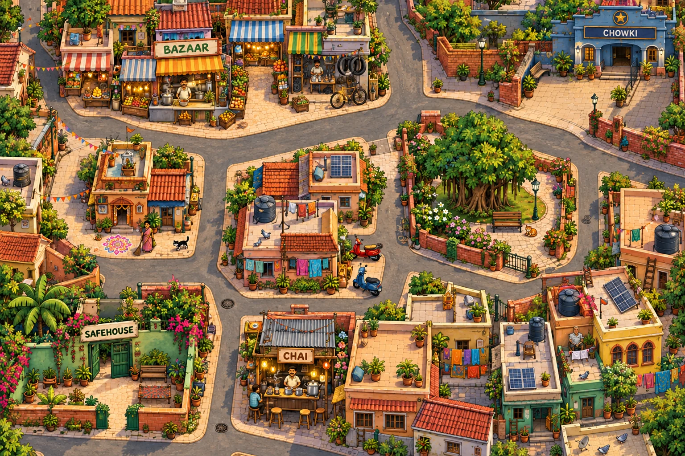
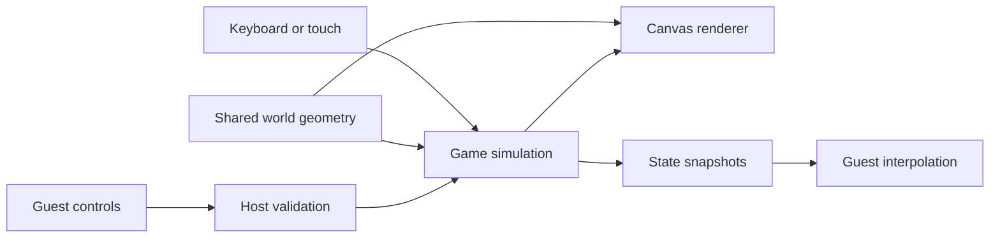

# Gully Chase

A JavaScript and Canvas neighbourhood chase game. Play as the chor or cop, share a keyboard, or create a two-player online room.

**[Play the demo](https://chorpolice-kappa.vercel.app)** · [Gameplay guide](docs/GAMEPLAY.md) · [Verification notes](docs/verification.md)



*The game's bundled map artwork; this is not a gameplay screenshot.*

## What you can play

- **Solo:** play either role against the simulation.
- **Local two-player:** share one keyboard.
- **Online:** the host plays chor and sends a room link to the cop.
- **Repeatable challenges:** a seed reproduces a round's layout.
- **Hindi dialogue:** device speech and captions; local recorded clips are optional.

The chor negotiates with three treasures and brings them home within 120 seconds. The cop wins by tagging the chor three times or preventing all three deliveries. Rooftops, chai camouflage, patrols, stamina, and timed events change the chase.

## Run locally

Requires Python 3. From the repository root:

```bash
python -m http.server 8080 --directory dist
```

Open `http://localhost:8080`. The `dist/` folder contains authored source files served directly; it is intentionally versioned. No build step, runtime API key, or dependency installation is needed for solo/local play.

## Engineering

| Decision | What it supports |
| --- | --- |
| Shared world geometry | Rendering, collisions, rooftops, and BFS navigation agree on the map |
| Browser-independent engine | Game rules can be exercised without a browser |
| Seeded randomness | Reproducible rounds and randomized layout checks |
| Host-authoritative online simulation | Guest controls are validated; the host sends state snapshots |
| Input expiry and heartbeat | Stale input stops and lost connections pause a round |
| Local assets and speech fallbacks | Gameplay remains usable without a paid voice service |



Online rooms use the bundled PeerJS client, cloud signaling, and WebRTC. The host tab must stay open. This is a trust-based two-player game; restrictive networks or signaling service availability may prevent a connection.

## Check the code

Requires Node.js 22 for the proposed CI environment:

```bash
npm run check
npm test
```

For the optional DOM flow harness:

```bash
npm ci
npm run test:dom
```

The harness exercises application modules with test data channels and mock media. It does not emulate native WebRTC, browser layout, touch hardware, or device speech. See [verification notes](docs/verification.md) for the existing test scope and limitations.

## Project layout

| Path | Responsibility |
| --- | --- |
| `dist/engine.js` | Rules, AI, collisions, and round state |
| `dist/world.js` | Geometry, navigation, and patrol routes |
| `dist/renderer.js`, `dist/world-art.js` | Canvas presentation |
| `dist/net-state.js`, `dist/online-room.js` | Networking, snapshots, and reconnects |
| `dist/app.js`, `dist/input.js` | Interface and controls |
| `tests/` | Simulation, network, audio, and presentation checks |
| `scripts/elevenlabs.mjs` | Optional offline voice generation |
| `vercel.json` | Static deployment configuration |

## Privacy and external services

Solo and local play use no gameplay service. Online mode exposes connection metadata to signaling/ICE services and the other peer. Voice generation is an optional maintainer task that can incur API charges; it is never needed to play. The checked-in voice manifest is empty.

## Status, deployment, and reuse

The repository includes a configured Vercel demo URL. Live availability and cross-device online play need a fresh manual check. Import the root into Vercel with **Other** as the framework and `dist` as the output directory; leave the build command empty.

No top-level project license was found. [Third-party notices](THIRD_PARTY_NOTICES.md) cover bundled dependencies; they do not license the entire game. A project license requires the owner's choice.

[Full mechanics, deployment details, and original verification narrative](docs/GAMEPLAY.md)
